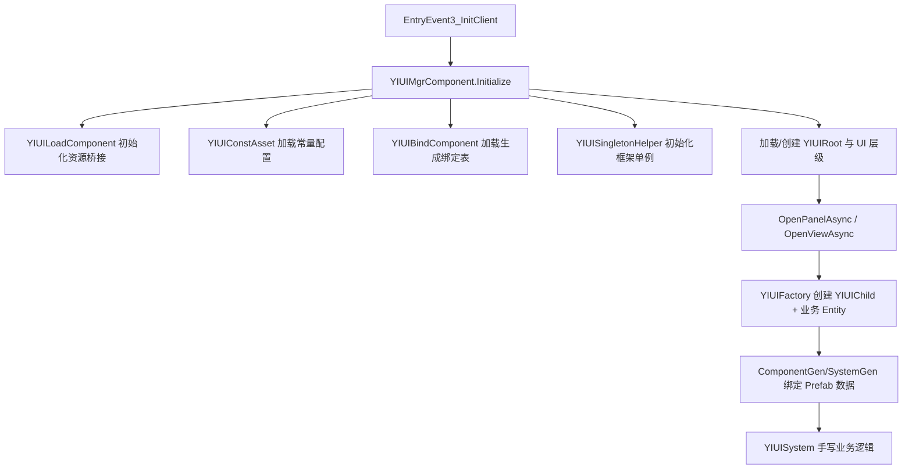
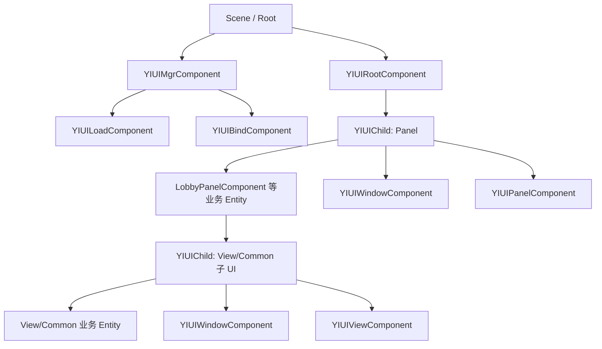
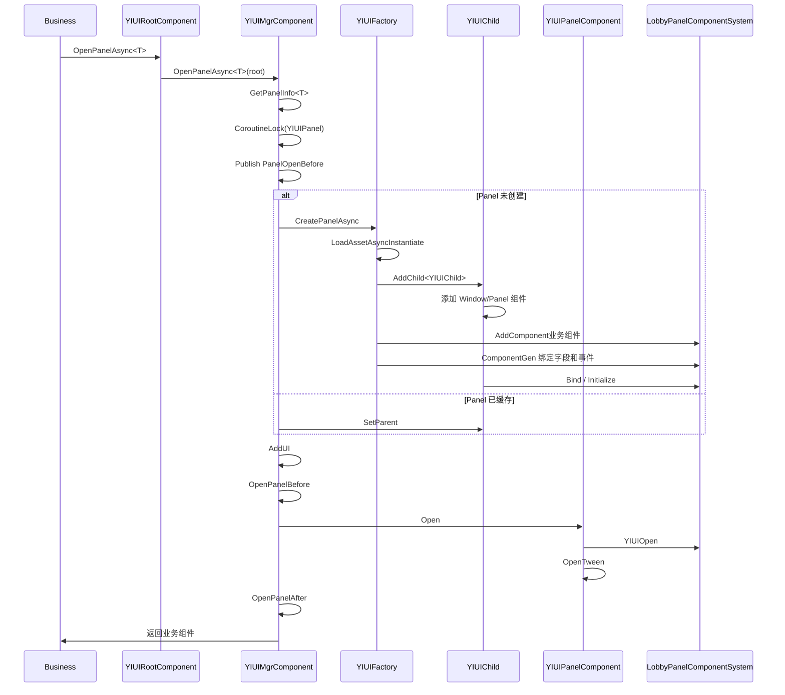

# YIUI 框架设计整理

本文基于当前工程内的 YIUI 相关包整理，重点描述框架在 ET 项目中的分层、核心实体、初始化链路、UI 创建与生命周期、资源加载桥接、生成代码边界和业务开发约定。

## 1. 总览

当前工程的 YIUI 是一套建立在 Unity UGUI、ET Entity/System、YooAssets、自动生成代码之上的 UI 框架。它的核心思路不是让 MonoBehaviour 直接承载业务逻辑，而是把 UI 的运行时状态挂到 ET Entity 树上，再由 Unity Prefab 上的绑定表和生成代码把 GameObject、组件、事件、数据绑定接入 ET 业务组件。

整体运行方式可以概括为：



## 2. 相关包职责

### 2.1 `cn.etetet.yiuiframework`

YIUI 框架主体。

主要内容：

- `Runtime/Core/YIUIBase`：YIUI 基础工具、配置、缓存、对象池、扩展方法
- `Runtime/Core/YIUIBind`：Unity 侧绑定系统，包括 CDE 表、数据绑定、事件绑定、Panel 配置枚举
- `Runtime/Core/YIUIMono`：少量 MonoBehaviour 控件扩展
- `Scripts/ModelView/Client`：ET 客户端表现层实体定义，例如 `YIUIMgrComponent`、`YIUIRootComponent`、`YIUIChild`
- `Scripts/HotfixView/Client`：UI 运行时逻辑，例如打开、关闭、层级管理、资源加载、生命周期调度
- `Editor/YIUIAutoTool`：YIUI 自动化工具，用于创建 UI、生成绑定代码、检查 Prefab 和脚本
- `DotNet~/SourceGenerator`：源码生成器和分析器，辅助生成/检查 YIUI EntitySystem

### 2.2 `cn.etetet.yiuiyooassets`

YIUI 与 YooAssets 的资源加载桥接包。框架主体只定义加载委托和调用边界，真正的同步/异步加载、资源有效性验证、释放逻辑由该包注册到 `YIUILoadDI`。

关键文件：

- `YIUIInvokeYooAssetsHandler.cs`
- `YIUIYooAssetsLoadComponentSystem.cs`
- `YIUILoadComponentSystem_YooAsset.cs`
- `YIUIInvokeLoadHandler.cs`
- `YIUIInvokeReleaseHandler.cs`

### 2.3 `cn.etetet.yiuistatesync`

当前项目的 YIUI 示例业务包，依赖 `statesync` 和多个 YIUI 扩展包。这里能看到完整业务示例：

- `EntryEvent3_InitClient.cs`：客户端第三阶段初始化里创建并初始化 `YIUIMgrComponent`
- `Scripts/ModelView/Client/YIUIGen`：自动生成 UI 组件字段
- `Scripts/ModelView/Client/YIUIComponent`：业务 UI Entity 的手写 partial 数据类
- `Scripts/HotfixView/Client/YIUIGen`：自动生成 UI System 绑定逻辑
- `Scripts/HotfixView/Client/YIUISystem`：业务手写生命周期与事件响应

### 2.4 `cn.etetet.yiuiluban` / `cn.etetet.yiuilubangen`

Luban 配置加载和生成产物。它们不是 YIUI 打开关闭链路的核心，但当前模板把配置系统和 UI 工具链一并接入，业务 UI 经常会读取 Luban 生成配置。

### 2.5 YIUI 扩展包

当前工程还包含：

- `cn.etetet.yiuigm`
- `cn.etetet.yiuitips`
- `cn.etetet.yiuireddot`
- `cn.etetet.yiuiaudio`
- `cn.etetet.yiuieffect`
- `cn.etetet.yiui3ddisplay`
- `cn.etetet.yiuiloopscrollrectasync`
- `cn.etetet.yiuiinvoke`

这些包通常通过框架事件、Invoke、组件扩展或初始化广播接入，不应把它们和 YIUI 主框架混在一个职责里理解。

## 3. 分层设计

YIUI 接入遵循 ET 四层分工：

| 层级 | 主要内容 | 当前 YIUI 示例 |
| --- | --- | --- |
| `Model` | 纯数据、共享配置、枚举 | `PackageType.cs`、`CoroutineLockType.cs` |
| `ModelView` | 客户端表现数据、Unity 轻量桥接 | `YIUIMgrComponent`、`YIUIChild`、`YIUIPanelComponent` |
| `Hotfix` | 与 UI 无关的热更业务逻辑 | 少量通用任务/计时扩展 |
| `HotfixView` | UI 表现逻辑、Unity 强相关逻辑 | 打开关闭、绑定、加载、动画、业务 UI System |

YIUI 的关键原则是：Prefab 和 MonoBehaviour 不直接承载主要业务状态，业务状态和行为放在 ET Entity 与静态 System 中。

## 4. 核心实体关系

### 4.1 Entity 树结构

运行期的典型 UI Entity 结构：



### 4.2 `YIUIMgrComponent`

全局 UI 管理器，挂在客户端 `Scene` 上。

职责：

- 持有 `YIUIRootComponent` 引用
- 创建和管理 UI 根节点 `YIUIRoot`
- 管理 `UICanvasRoot`、`UILayerRoot`、`UICamera`、`Canvas`
- 维护所有 UI 层级 `m_AllPanelLayer`
- 缓存已打开过的 `PanelInfo`
- 挂载 `YIUILoadComponent` 和 `YIUIBindComponent`
- 作为 Open/Close/Home/Back 等高级 API 的实际执行者

常用入口：

- `scene.YIUIMgr()`
- `scene.YIUIRoot()`
- `scene.YIUIMgr().ClosePanelAsync<T>()`
- `scene.YIUIRoot().OpenPanelAsync<T>()`

### 4.3 `YIUIRootComponent`

当前场景的 UI 入口代理，实际挂在 `Scene.Root()` 上。

职责：

- 保存 `YIUIMgrComponent` 引用
- 添加 `HashWait`，支持打开等待流程
- 提供更贴近业务的 OpenPanel API，把调用转发给 `YIUIMgrComponent`

业务打开主面板通常优先用：

```csharp
await scene.YIUIRoot().OpenPanelAsync<LobbyPanelComponent>();
```

### 4.4 `YIUIChild`

每个 UI Prefab 实例对应一个 `YIUIChild`，它是 Unity GameObject 和 ET 业务 Entity 的桥。

职责：

- 持有 Prefab 实例 `OwnerGameObject`
- 持有 `OwnerRectTransform`
- 持有 `UIBindCDETable`、`ComponentTable`、`DataTable`、`EventTable`
- 持有生成绑定信息 `YIUIBindVo`
- 持有实际业务 Entity 引用 `OwnerUIEntity`
- 根据 `EUICodeType` 自动挂载 `YIUIWindowComponent`、`YIUIPanelComponent`、`YIUIViewComponent`
- 将 Unity 的 Enable/Disable/Destroy 转发到 YIUI 生命周期

`YIUIChild` 的创建由 `YIUIFactory.CreateByObjVo` 完成。它要求 Prefab 上必须存在 `UIBindCDETable`。

### 4.5 `YIUIPanelComponent`

Panel 类型 UI 的运行时控制组件，挂在 Panel 的 `YIUIChild` 下。

职责：

- 保存 `YIUIBindVo`
- 标记所在层级 `EPanelLayer`
- 保存面板行为选项 `EPanelOption`
- 保存堆栈行为 `EPanelStackOption`
- 保存同层级排序优先级 `Priority`
- 管理 Panel 内 View 的打开、关闭、缓存与当前 View
- 处理关闭后的缓存销毁倒计时

### 4.6 `YIUIViewComponent`

View 类型 UI 的运行时控制组件，挂在 View 的 `YIUIChild` 下。

职责：

- 作为 Panel 内部可切换 View 的控制入口
- 支持 `EViewWindowType` 区分普通 View 和 Popup View
- 支持 `EViewStackOption` 控制同组 View 的显隐/动画行为

### 4.7 `YIUIWindowComponent`

Panel 和 View 都会挂载的窗口行为组件。

职责：

- 保存窗口选项 `EWindowOption`
- 判断业务 Entity 是否实现打开/关闭动画接口
- 封装打开动画、关闭动画、动画结束回调
- 动画期间按配置屏蔽 UI 操作层
- 默认 Panel 可走 `WindowFadeAnim`

### 4.8 `YIUILoadComponent`

全局 UI 资源加载组件，挂在 `YIUIMgrComponent` 下。

职责：

- 统一封装 UI 资源加载、实例化、释放
- 维护资源引用计数
- 通过协程锁避免同一资源重复并发加载
- 通过 `YIUILoadDI` 调用具体资源系统

### 4.9 `YIUIBindComponent`

全局 UI 绑定表组件，挂在 `YIUIMgrComponent` 下。

职责：

- 从 `YIUICodeGenerated.YIUIBindProvider.Get()` 读取自动生成绑定表
- 建立 Type 到 `YIUIBindVo` 的映射
- 建立 `pkgName + resName` 到 `YIUIBindVo` 的映射
- 在当前 YooAssets 资源名唯一约定下，建立 `resName` 到 `YIUIBindVo` 的快捷映射

## 5. 关键数据结构

### 5.1 `YIUIBindVo`

自动生成的 UI 资源绑定描述：

```csharp
public struct YIUIBindVo
{
    public EUICodeType CodeType;
    public Type ComponentType;
    public string PkgName;
    public string ResName;
    public EPanelLayer PanelLayer;
}
```

它是“业务组件类型”和“UI 资源”之间的核心协议。

### 5.2 `PanelInfo`

`YIUIMgrComponent` 用 `PanelInfo` 缓存已打开过的 Panel 配置和运行时实例。

包含：

- `BindVo`
- `PkgName`
- `ResName`
- `Name`
- `PanelLayer`
- `YIUIChild`
- `YIUIWindowComponent`
- `YIUIPanelComponent`
- 业务 `OwnerUIEntity`
- 预加载的 `GameObject`

`YIUIBindVo` 是静态绑定数据，`PanelInfo` 是运行时缓存数据。框架没有直接拿 `YIUIBindVo` 当 Panel 状态，是因为 Panel 打开后需要记录实例、窗口组件、面板组件、预加载对象等运行时引用。

### 5.3 `EUICodeType`

UI 类型：

- `Panel`：面板，受层级、回退、缓存、关闭逻辑管理
- `View`：Panel 内部视图
- `Common`：通用组件

### 5.4 `EPanelLayer`

Panel 层级，从前到后包括：

- `Top`：最高层，适合新手引导等
- `Tips`：提示层，适合飘字、确认弹窗、跑马灯等
- `Popup`：弹窗层，适合非全屏可叠加弹窗
- `Panel`：普通全屏面板层，受回退和堆栈逻辑影响
- `Scene`：场景 UI 层
- `Bottom`：最低层
- `Cache`：缓存层，隐藏不显示

初始化时 `YIUIMgrComponent.InitRoot` 会在 `YIUILayerRoot` 下按枚举创建层级节点，并把 `Cache` 层隐藏。

### 5.5 `EPanelOption`

Panel 行为标记：

- `Container`：容器类界面
- `ForeverCache`：永久缓存，关闭后不销毁
- `TimeCache`：倒计时缓存，关闭后延迟销毁
- `DisClose`：禁止关闭
- `IgnoreBack`：忽略回退/堆栈逻辑
- `IgnoreClose`：忽略非指向性关闭

### 5.6 `EPanelStackOption`

同层 Panel 打开时的堆栈策略：

- `None`：不做显隐处理，叠加管理
- `Visible`：显隐旧界面，不触发动画
- `VisibleTween`：显隐旧界面，并触发动画
- `Omit`：打开其他界面时自己被关闭，不进入常规堆栈

### 5.7 `EWindowOption`

窗口行为标记，控制 Open 参数兼容、打开关闭顺序、动画、Home/Back 行为等。

典型选项：

- `CanUseBaseOpen`
- `BanParamOpen`
- `HaveIOpenAllowOpen`
- `FirstOpen`
- `LastClose`
- `BanOpenTween`
- `BanCloseTween`
- `BanRepetitionOpenTween`
- `BanRepetitionCloseTween`
- `BanAwaitOpenTween`
- `BanAwaitCloseTween`
- `SkipOtherOpenTween`
- `SkipOtherCloseTween`
- `SkipHomeOpenTween`
- `AllowOptionByTween`
- `SkipHomeBack`

## 6. 初始化流程

### 6.1 业务入口

当前项目在 `Packages/cn.etetet.yiuistatesync/Scripts/HotfixView/Client/EntryEvent3_InitClient.cs` 中初始化 UI。

关键流程：

```csharp
var result = await root.AddComponent<YIUIMgrComponent>().Initialize();
if (!result)
{
    Log.Error("初始化UI失败");
    return;
}
```

`YIUIMgrComponent` 是 UI 框架真正启动点。

### 6.2 `YIUIMgrComponent.Initialize`

初始化顺序：

1. 添加 `YIUILoadComponent`
2. 调用 `YIUILoadComponent.Initialize`
3. 加载 `YIUIConstAsset`
4. 添加 `YIUIBindComponent`
5. 从 `YIUICodeGenerated.YIUIBindProvider.Get()` 初始化绑定表
6. 发布 `YIUIEventInitializeBefore`
7. 初始化 YIUI 单例
8. 初始化 `YIUIRoot`
9. 初始化安全区
10. 发布 `YIUIEventInitializeAfter`

这个顺序体现了框架设计边界：资源系统、配置、绑定表、单例、Root、扩展模块各自有明确阶段。

### 6.3 初始化扩展点

框架提供两个初始化广播：

- `YIUIEventInitializeBefore`：YIUI 单例初始化前
- `YIUIEventInitializeAfter`：YIUI Root 初始化后

扩展模块应该通过事件接入，而不是直接改 `YIUIMgrComponentSystem_Initialize.cs`。

## 7. UI Root 与层级

`YIUIMgrComponent.InitRoot` 会先查找场景中是否已经存在 `YIUIRoot`，如果不存在则通过 `YIUILoadComponent` 加载并实例化。

Root 初始化做的事：

- 查找或创建 `YIUIRoot`
- `DontDestroyOnLoad`
- 设置根节点偏移，避免与 3D 场景编辑冲突
- 获取 `Canvas`
- 查找 `YIUILayerRoot`
- 获取 `UICamera`
- 设置 `Canvas.renderMode = ScreenSpaceCamera`
- 设置 `CanvasScaler.ScaleWithScreenSize`
- 按 `EPanelLayer` 创建层级节点
- 隐藏 `Cache` 层
- 添加 UI 操作屏蔽层
- 初始化 UI Camera

层级数据保存在：

```csharp
Dictionary<EPanelLayer, Dictionary<RectTransform, List<PanelInfo>>> m_AllPanelLayer
```

当前实现每个 `EPanelLayer` 只有一个 `RectTransform`，内部 `List<PanelInfo>` 表示该层当前 UI 顺序。

## 8. 打开 Panel 流程

以 `scene.YIUIRoot().OpenPanelAsync<LobbyPanelComponent>()` 为例：



### 8.1 获取 `PanelInfo`

`GetPanelInfo<T>` 使用业务组件类型查 `YIUIBindComponent`。如果没有缓存，就创建 `PanelInfo`。

如果使用字符串打开，组件名必须以 `PanelComponent` 结尾，并通过资源名反查绑定信息。

### 8.2 打开协程锁

Panel 打开使用 `CoroutineLockType.YIUIPanel`。

锁规则：

- 普通 `Panel` 层使用项目名 hash，保证全屏 Panel 打开关闭串行
- 非 `Panel` 层使用 panelName hash，允许不同弹层相对独立

### 8.3 创建 UI

`YIUIFactory.CreatePanelAsync` 会：

1. 根据 `PanelInfo.PkgName/ResName` 找 `YIUIBindVo`
2. 通过 `YIUILoadComponent` 加载并实例化 Prefab
3. 调用 `CreateByObjVo`
4. 检查 Prefab 上的 `UIBindCDETable`
5. 创建 `YIUIChild`
6. 添加业务组件 `vo.ComponentType`
7. 递归创建子 CDE 组件
8. 调用 `InitOwnerUIEntity`
9. 触发 Bind/Initialize

### 8.4 Open 生命周期

Panel 的 `Open` 最终会调用业务组件实现的接口：

- `IYIUIOpen`
- `IYIUIOpen<P1>`
- `IYIUIOpen<P1, P2>`
- `IYIUIOpen<P1, P2, P3>`
- `IYIUIOpen<P1, P2, P3, P4>`
- `IYIUIOpen<P1, P2, P3, P4, P5>`
- `IYIUIOpen<ParamVo>`

接口本身只是标记，真正执行由对应 `YIUIOpenSystem<T>` 派发到手写 System。

示例：

```csharp
[EntitySystem]
private static async ETTask<bool> YIUIOpen(this LobbyPanelComponent self)
{
    await ETTask.CompletedTask;
    return true;
}
```

## 9. 关闭与回退

### 9.1 主动关闭

常用方式：

```csharp
await scene.YIUIMgr().ClosePanelAsync<LoginPanelComponent>();
await self.UIPanel.CloseAsync();
```

`YIUIPanelComponent.CloseAsync` 通过 Invoke 事件进入管理器：

```csharp
YIUIInvokeEntity_ClosePanel
```

这能保证关闭逻辑统一经过层级、堆栈、动画、缓存、事件发布。

### 9.2 堆栈回退

只对 `EPanelLayer.Panel` 层的普通面板有完整回退/堆栈逻辑。

打开一个新 Panel 时：

- 如果新 Panel 没有 `IgnoreBack`
- 管理器遍历当前 Panel 层
- 根据旧 Panel 的 `EPanelStackOption` 决定隐藏、播放动画、关闭或跳过
- 如旧 UI 实现 `IYIUIBackClose`，会收到回退关闭事件

关闭当前 Panel 时：

- 管理器从层级列表恢复前一个符合规则的 Panel
- 如恢复 UI 实现 `IYIUIBackOpen`，会收到回退打开事件

### 9.3 Home 行为

`Home<T>` 用于回到指定 Panel。

相关接口：

- `IYIUIBackHomeClose`
- `IYIUIBackHomeOpen`

Home 时可由 `EWindowOption` 控制是否跳过回退回调、是否跳过动画。

### 9.4 关闭后的缓存

由 `EPanelOption` 控制：

- `ForeverCache`：关闭后放入缓存层，不销毁
- `TimeCache`：关闭后启动倒计时，时间到再销毁
- 无缓存：关闭后直接移除并销毁

倒计时由 `YIUIPanelComponentSystem_TimeDestroy` 使用 `TimerComponent` 和 `ETCancellationToken` 实现。

## 10. View 与 Common

### 10.1 View

View 是 Panel 内部的可切换子界面。它同样会创建：

- `YIUIChild`
- 业务 View Entity
- `YIUIWindowComponent`
- `YIUIViewComponent`

View 支持：

- 普通 View / Popup View
- `EViewStackOption` 堆栈显隐策略
- 打开关闭动画
- 从 View 发起关闭所属 Panel

### 10.2 Common

Common 是通用复用组件。它不会自动拥有 Panel/View 的层级与窗口管理能力，适合按钮块、列表项、通用子控件等。

如果 Common 需要响应 Open/Close 等事件，可以让业务 Entity 实现对应接口，再由父 UI 调用子 UI 扩展方法。

`YIUIChildSystem_Event` 提供：

- `OpenAllChild`
- `OpenAllChildSync`
- `CloseAllChild`
- `CloseAllChildSync`

这些方法遍历业务 Entity 的子节点，找到其中的 `YIUIChild` 并分发生命周期。

## 11. 生命周期接口体系

YIUI 自定义了一组接口，和 ET EntitySystem 配合使用。

### 11.1 创建期

- `IAwake`：ET Entity 创建时
- `IYIUIBind`：绑定 Prefab 组件、事件、数据
- `IYIUIInitialize`：UI 数据组件初始化后
- `IDestroy`：Entity 销毁时

`YIUIChild.InitOwnerUIEntity` 会触发：

1. UI 数据组件初始化
2. `YIUIEventSystem.Bind`
3. `YIUIEventSystem.Initialize`
4. 注册 Enable/Disable 回调

### 11.2 打开关闭

- `IYIUIOpen`
- `IYIUIOpen<T...>`
- `IYIUIClose`
- `IYIUIDisClose`

`IYIUIClose` 表示业务关闭前可执行逻辑并返回是否成功。`IYIUIDisClose` 用于被禁止关闭或拒绝关闭时的响应。

### 11.3 Enable / Disable

- `IYIUIEnable`
- `IYIUIDisable`

由 `UIBindCDETable` 的 Unity Enable/Disable 回调转发。只有业务 Entity 实现对应接口时才注册。

### 11.4 动画

- `IYIUIOpenTween`
- `IYIUICloseTween`
- `IYIUIOpenTweenEnd`
- `IYIUICloseTweenEnd`

如果业务没有实现动画接口，Panel 默认可走 `WindowFadeAnim`。如果配置禁用动画或低品质模式，框架会跳过动画但仍触发动画结束回调。

### 11.5 回退

- `IYIUIBackClose`
- `IYIUIBackOpen`
- `IYIUIBackHomeClose`
- `IYIUIBackHomeOpen`

这些接口用于 Panel 层堆栈和 Home 操作，不是普通 Close/Open 的替代。

## 12. 资源加载设计

### 12.1 框架抽象

`YIUILoadComponent` 不直接依赖 YooAssets。它通过 `YIUILoadDI` 中的委托完成具体资源系统调用：

- `LoadAssetFunc`
- `LoadAssetAsyncFunc`
- `VerifyAssetValidityFunc`
- `ReleaseAction`
- `ReleaseAllAction`

这种设计允许替换资源系统。

### 12.2 当前 YooAssets 实现

`cn.etetet.yiuiyooassets` 在 `YIUIYooAssetsLoadComponent.Initialize` 中注册委托：

```csharp
YIUILoadDI.LoadAssetAsyncFunc = self.LoadAssetAsyncFunc;
YIUILoadDI.ReleaseAction = self.ReleaseAction;
YIUILoadDI.VerifyAssetValidityFunc = self.VerifyAssetValidityFunc;
YIUILoadDI.ReleaseAllAction = self.ReleaseAllAction;
```

默认资源包名：

```csharp
"DefaultPackage"
```

YooAssets 的定位主要使用 `resName`。该包还扩展了不传 `pkgName` 的快捷加载方法。

### 12.3 引用计数与实例释放

`LoadAssetAsync<T>` 会：

1. 通过 `LoadHelper.GetLoad(pkgName, resName)` 获取加载句柄
2. 增加引用计数
3. 如果对象已加载则直接返回
4. 通过 `CoroutineLockType.YIUILoad` 防止重复加载
5. 调用 `YIUILoadDI.LoadAssetAsyncFunc`
6. 保存对象和资源系统 hashCode

Prefab 实例化会额外记录：

```csharp
YIUILoadHelperStatic.g_ObjectMap[obj] = asset;
```

释放实例时先映射回原始资源，再减少资源引用计数。

## 13. 自动生成代码与手写代码边界

### 13.1 典型文件布局

以 `LobbyPanelComponent` 为例：

| 文件 | 性质 | 是否手改 |
| --- | --- | --- |
| `ModelView/Client/YIUIGen/Lobby/LobbyPanelComponentGen.cs` | 自动生成字段、属性、接口、`YIUI` 特性 | 不手改 |
| `ModelView/Client/YIUIComponent/Lobby/LobbyPanelComponent.cs` | 手写 partial 数据扩展 | 可手改 |
| `HotfixView/Client/YIUIGen/Lobby/LobbyPanelComponentSystemGen.cs` | 自动生成绑定逻辑 | 不手改 |
| `HotfixView/Client/YIUISystem/Lobby/LobbyPanelComponentSystem.cs` | 手写业务生命周期和事件响应 | 可手改 |

### 13.2 ComponentGen

生成内容通常包括：

- `[YIUI(EUICodeType.Panel, EPanelLayer.Panel)]`
- `[ComponentOf(typeof(YIUIChild))]`
- 业务组件继承 `Entity`
- 生命周期接口声明
- `PkgName`
- `ResName`
- `YIUIChild`、`YIUIWindowComponent`、`YIUIPanelComponent` 引用
- 绑定事件字段
- 事件 Invoke 名常量

### 13.3 SystemGen

生成内容通常包括：

- `[EntitySystemOf(typeof(XxxComponent))]`
- `Awake`
- `YIUIBind`
- 自动查找 `UIBase`
- 自动查找 `UIWindow`
- 自动查找 `UIPanel`
- 写入窗口、面板、缓存、层级、优先级等配置
- 查找事件并绑定到 `[YIUIInvoke]` 方法

### 13.4 手写 YIUISystem

业务代码应写在 `YIUISystem` 下。

示例：

```csharp
[FriendOf(typeof(LobbyPanelComponent))]
public static partial class LobbyPanelComponentSystem
{
    [EntitySystem]
    private static void YIUIInitialize(this LobbyPanelComponent self)
    {
    }

    [EntitySystem]
    private static async ETTask<bool> YIUIOpen(this LobbyPanelComponent self)
    {
        await ETTask.CompletedTask;
        return true;
    }

    [YIUIInvoke(LobbyPanelComponent.OnEventEnterMapInvoke)]
    private static async ETTask OnEventEnterMapInvoke(this LobbyPanelComponent self)
    {
        self.UIBase.SetActive(false);
        await EnterMapHelper.EnterMapAsync(self.Root());
        await self.UIPanel.CloseAsync();
    }
}
```

不要手改 `YIUIGen`，Prefab 结构或绑定变化后应重新运行 YIUI 自动化工具。

## 14. 事件与 Invoke 体系

### 14.1 Publish 事件

框架通过 ET 事件广播 UI 生命周期：

- `YIUIEventInitializeBefore`
- `YIUIEventInitializeAfter`
- `YIUIEventPanelOpenBefore`
- `YIUIEventPanelOpenAfter`
- `YIUIEventPanelCloseBefore`
- `YIUIEventPanelCloseAfter`
- `YIUIEventPanelDestroy`
- `YIUIEventViewOpenBefore`

这些适合模块级监听，例如 Tips、RedDot、GM、倒计时管理器等扩展。

### 14.2 Invoke 事件

框架用 Invoke 表达强约束调用：

- `YIUIInvokeEntity_LoadInitialize`
- `YIUIInvokeEntity_ClosePanel`
- `YIUIInvokeEntity_HomePanel`
- `YIUIInvokeEntity_RemoveUIReset`
- `YIUIInvokeEntity_DestroyPanel`
- `YIUIInvokeEntity_ViewClosePanel`
- `YIUIInvokeEntity_LoadInstantiate`

业务层不应绕过这些 Invoke 直接改内部状态，否则容易破坏层级、缓存、动画和释放流程。

### 14.3 UI 事件绑定

Prefab 上的事件通过 `UIBindEventTable` 进入生成代码，生成代码再绑定到手写方法：

```csharp
self.u_EventEnterMap = self.UIBase.EventTable.FindEvent<UITaskEventP0>("u_EventEnterMap");
self.u_EventEnterMapHandle = self.u_EventEnterMap.Add(self, LobbyPanelComponent.OnEventEnterMapInvoke);
```

手写方法使用：

```csharp
[YIUIInvoke(LobbyPanelComponent.OnEventEnterMapInvoke)]
private static async ETTask OnEventEnterMapInvoke(this LobbyPanelComponent self)
```

## 15. 配置与常量

`YIUIConstAsset` 是 YIUI 的常量配置，运行时通过 `YIUIConstHelper.LoadAsset(scene)` 加载。

关键配置：

- `UIProjectName = "YIUI"`
- `UINamespace = "ET.Client"`
- `UIProjectResPath = "Assets/GameRes/YIUI"`
- `UIETComponentGenPath`
- `UIETComponentPath`
- `UIETSystemGenPath`
- `UIETSystemPath`
- `UIRootName = "YIUIRoot"`
- `UILayerRootName = "YIUILayerRoot"`
- `UIRootPkgName = "Common"`
- `DesignScreenWidth = 1920`
- `DesignScreenHeight = 1080`
- `RootPosOffset = 1000`
- `LayerDistance`
- `IsLowQuality`
- `BanDotweenAnim`

这些配置同时影响编辑器生成路径、运行时 Root 加载、Canvas 缩放和动画策略。

## 16. 当前项目业务接入方式

### 16.1 启动 UI

当前项目 UI 在 `EntryEvent3_InitClient` 中随客户端初始化启动。初始化完成后发布：

```csharp
await EventSystem.Instance.PublishAsync(root, new AppStartInitFinish());
```

登录 UI、Lobby UI 等业务通过后续事件打开/关闭。

### 16.2 示例打开

```csharp
await scene.YIUIRoot().OpenPanelAsync<LobbyPanelComponent>();
```

### 16.3 示例关闭

```csharp
await scene.YIUIMgr().ClosePanelAsync<LoginPanelComponent>();
```

### 16.4 示例按钮事件

`LobbyPanelComponentSystem` 中：

```csharp
[YIUIInvoke(LobbyPanelComponent.OnEventEnterMapInvoke)]
private static async ETTask OnEventEnterMapInvoke(this LobbyPanelComponent self)
{
    self.UIBase.SetActive(false);
    await EnterMapHelper.EnterMapAsync(self.Root());
    await self.UIPanel.CloseAsync();
}
```

这体现了业务逻辑应通过 ET System 执行，而不是写在 Unity Button 的 MonoBehaviour 中。

## 17. 开发约定

### 17.1 新增 UI 的推荐流程

1. 使用 YIUI 自动化工具创建 Panel/View/Common
2. 在 Prefab 上完成绑定
3. 重新生成 YIUI 代码
4. 不修改 `YIUIGen`
5. 在 `YIUIComponent` 中补充业务数据字段
6. 在 `YIUISystem` 中编写生命周期、打开关闭、事件响应
7. 通过 `YIUIRoot` 或 `YIUIMgr` API 打开/关闭

### 17.2 代码放置

正式项目业务优先放：

- `Packages/cn.etetet.gameplay`
- 或新增独立业务包

模板示例 UI 可参考：

- `Packages/cn.etetet.yiuistatesync`

通用 UI 能力或跨项目基础能力可放：

- `Packages/cn.etetet.gamebase`

### 17.3 不建议做的事

- 不要手改 `YIUIGen/*Gen.cs`
- 不要绕过 `YIUIMgrComponent` 直接 Destroy Panel GameObject
- 不要直接改 `m_AllPanelLayer`、`PanelInfo` 等内部状态
- 不要在业务里自己处理 YooAssets 句柄并塞回 YIUI
- 不要把主要 UI 业务写到 MonoBehaviour
- 不要把 Panel/View/Common 的生成配置和手写逻辑混在一个文件里
- 不要长期依赖字符串打开，类型打开更容易被编译期约束保护

## 18. 常见问题排查

### 18.1 UI 初始化失败

检查：

1. `EntryEvent3_InitClient` 是否执行
2. 是否添加 `YIUIMgrComponent`
3. `YIUILoadComponent.Initialize` 是否成功
4. YooAssets 默认包是否存在
5. `YIUIConstAsset` 是否能加载
6. `YIUICodeGenerated.YIUIBindProvider.Get()` 是否返回绑定数据
7. `YIUIRoot` 资源是否存在
8. `YIUIRoot` 下是否有 `Canvas`、`YIUILayerRoot`、`UICamera`

### 18.2 打不开 Panel

检查：

1. 业务组件是否有 `[YIUI(EUICodeType.Panel, ...)]`
2. 是否重新生成了 YIUI 代码
3. `YIUIBindComponent` 是否能通过 Type 找到 `YIUIBindVo`
4. Prefab 资源名是否和 `ResName` 一致
5. YooAssets location 是否有效
6. Prefab 上是否有 `UIBindCDETable`
7. 业务组件是否实现了对应参数的 `IYIUIOpen`
8. 生成的 `SystemGen` 是否绑定了必要字段

### 18.3 按钮事件不触发

检查：

1. Prefab 事件是否绑定到 `UIBindEventTable`
2. 是否重新生成代码
3. `SystemGen` 是否找到事件字段
4. 手写方法是否有 `[YIUIInvoke(...)]`
5. Invoke 名是否使用生成常量
6. 方法签名是否匹配事件参数

### 18.4 关闭后界面没销毁

检查：

1. `EPanelOption` 是否设置了 `ForeverCache`
2. 是否设置了 `TimeCache`
3. `CachePanelTime` 是否大于 0
4. 是否设置了 `DisClose`
5. 是否调用的是非指向性关闭且 Panel 有 `IgnoreClose`
6. 是否通过 `YIUIChild.SetActive(false)` 只隐藏了对象

### 18.5 回退表现异常

检查：

1. Panel 是否在 `EPanelLayer.Panel`
2. Panel 是否设置了 `IgnoreBack`
3. `EPanelStackOption` 是否符合预期
4. `EWindowOption.FirstOpen/LastClose` 是否影响顺序
5. 是否跳过了其他界面动画
6. 是否绕过 `YIUIMgrComponent` 直接隐藏或销毁

### 18.6 资源无法释放

检查：

1. 是否通过 `YIUILoadComponent` 加载
2. 实例化对象是否通过框架释放路径销毁
3. `YIUILoadHelperStatic.g_ObjectMap` 是否能映射实例到原资源
4. YooAssets handle 是否由 `YIUIYooAssetsLoadComponent` 管理
5. 是否有业务自己持有资源引用未释放

## 19. 设计取舍总结

当前 YIUI 接入有几个明确取舍：

- UI 业务状态归 ET Entity，不归 MonoBehaviour
- Prefab 只作为表现和绑定载体
- 自动生成代码负责把 Prefab 结构变成类型安全访问入口
- 手写业务只写在 partial Entity 和 partial System 中
- Panel 的打开关闭必须经过管理器统一维护状态
- 资源系统通过 DI 委托接入，YIUI 主体不硬依赖 YooAssets
- UI 生命周期用接口和 EntitySystem 派发，避免业务散落在 Unity 回调里
- 扩展模块通过 Publish/Invoke 接入初始化和生命周期节点

如果后续新增正式业务 UI，建议继续沿用这条边界：Prefab 结构变化交给 YIUI 工具生成，业务状态放 Entity，业务逻辑放 `YIUISystem`，资源和关闭流程走框架 API。

